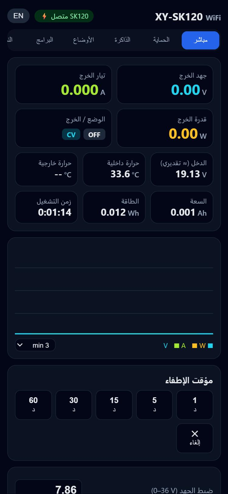
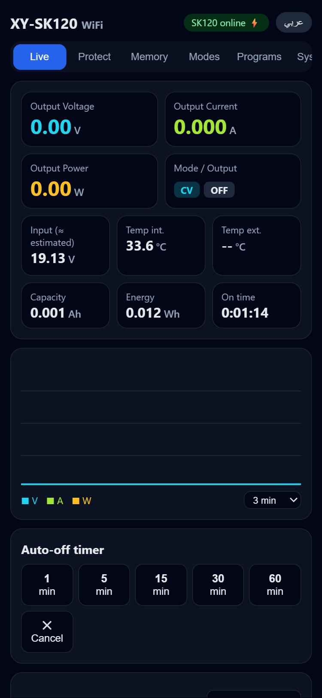

# XY-SK120 WiFi Controller — تحكم لاسلكي بمزود الطاقة SK120

[](https://github.com/TechFury-commits/sk120-wifi-controller/actions/workflows/build.yml)
[](https://github.com/TechFury-commits/sk120-wifi-controller/releases/latest)
[](LICENSE)
[](https://alatekka.com/project.html?p=sk120-wifi)

**[⚡ Install from your browser / ثبّت من المتصفح](https://alatekka.com/project.html?p=sk120-wifi)** · [العربية](#العربية) · [English](#english) · [Docs](#docs--التوثيق)

<p align="center"> </p>

---

## العربية

سوفت وير لموديول **ESP-01 (ESP8266)** يحوّل مزود الطاقة **XY-SK120** إلى جهاز تتحكم فيه من الجوال أو الكمبيوتر عبر الواي فاي، بواجهة عربية وإنجليزية.

### المميزات
- **قراءة لحظية (WebSocket):** حوالي 6 قراءات في الثانية للجهد والتيار والقدرة وجهد الدخل والحرارة والسعة والطاقة.
- **التحكم:** ضبط الجهد والتيار، تشغيل وإطفاء الخرج، قفل أزرار الجهاز.
- **الحمايات:** LVP و OVP و OCP و OPP و OHP و OAH و OWH و OTP، وذاكرات M0–M9.
- **الأوضاع:** قدرة ثابتة CP، و MPPT للألواح الشمسية، وشاحن بطاريات (Li-ion و LiFePO4 والرصاص).
- **البرامج:** تشغيل ناعم، مؤقت إطفاء، جدول يومي، وبرنامج خطوات يصل إلى 10 خطوات.
- **السجل:** رسم بياني لآخر 30 دقيقة، وتحميل CSV.
- **التنبيهات:** تيليجرام، و MQTT مع اكتشاف تلقائي في Home Assistant.
- **الصيانة:** تحديث عبر الواي فاي (`/update`)، وعلامة الواي فاي على شاشة الجهاز.

### التثبيت
1. **من المتصفح:** افتح صفحة المشروع على [alatekka.com](https://alatekka.com/project.html?p=sk120-wifi) بمتصفح Chrome أو Edge، ووصّل الـ ESP-01 بمبرمجة USB في وضع البرمجة (GPIO0 على GND).
2. **أو عبر Arduino IDE:** نواة ESP8266 3.1.2، ومكتبة ArduinoMqttClient، واللوحة Generic ESP8266 Module، والذاكرة 1MB (FS:64KB)، ووضع الفلاش DOUT.
3. **في قائمة الـ SK120:** اضبط العنوان على 1، والسرعة bRE على 6 (115200) أو 8 (4800)، ثم أعد تشغيل الجهاز. الموديول يكتشف السرعة تلقائياً.
4. **الاتصال:** اتصل بشبكة `SK120-AP` (كلمة المرور `12345678`) وافتح `192.168.4.1`، ثم اربطه بشبكة البيت من تبويب «الشبكة». بعدها افتحه من `http://sk120.local`.

> غيّر كلمة مرور الـ AP بعد التثبيت، لأنها نفسها كلمة مرور صفحة التحديث.

---

## English

Firmware for an **ESP-01 (ESP8266)** that turns the **XY-SK120** buck-boost power supply into a WiFi device you control from a phone or computer, with an Arabic / English web UI.

### Features
- **Live readings (WebSocket):** about 6 per second for V, I, P, input voltage, temperature, Ah and Wh.
- **Control:** set V and I, switch the output on and off, lock the front-panel keys.
- **Protections:** LVP, OVP, OCP, OPP, OHP, OAH, OWH and OTP, plus memory groups M0–M9.
- **Modes:** constant power (CP), MPPT for solar input, and a battery charger (Li-ion, LiFePO4, lead-acid).
- **Programs:** soft start, auto-off timer, daily schedule, and a step program of up to 10 steps.
- **Logging:** 30-minute chart and CSV download.
- **Alerts:** Telegram, and MQTT with Home Assistant auto-discovery.
- **Maintenance:** OTA updates (`/update`) and the WiFi icon on the SK120 screen.

### Install
1. **From the browser:** open the project page on [alatekka.com](https://alatekka.com/project.html?p=sk120-wifi) in Chrome or Edge, with the ESP-01 on a USB programmer in flash mode (GPIO0 to GND).
2. **Or with Arduino IDE:** ESP8266 core 3.1.2, the ArduinoMqttClient library, board Generic ESP8266 Module, Flash 1MB (FS:64KB), flash mode DOUT.
3. **In the SK120 menu:** set address 1 and baud `bRE` = 6 (115200) or 8 (4800), then power-cycle the SK120. The module auto-detects the baud.
4. **Connect:** join `SK120-AP` (password `12345678`), open `192.168.4.1`, and add your home WiFi in the Network tab. After that, open the device at `http://sk120.local`.

> Change the AP password after setup, because it is also the OTA update password.

### Notes
- Tested on SK120 model 22873, firmware 136. The screensaver clock (0x0200) needs the newer SK120X.
- The SK120 has no input-current sensor; the UI shows an estimate (90 % efficiency).

---

## Docs / التوثيق

| | |
|---|---|
| [docs/HARDWARE.md](docs/HARDWARE.md) | Wiring, SK120 menu, flashing · التوصيل والبرمجة |
| [docs/API.md](docs/API.md) | HTTP, WebSocket and MQTT API · واجهة البرمجة |
| [docs/REGISTERS.md](docs/REGISTERS.md) | Verified Modbus register map · خريطة الريجسترات |
| [CHANGELOG.md](CHANGELOG.md) | Version history · سجل الإصدارات |

## Project layout / بنية المشروع

```
firmware/SK120_Full/
  SK120_Full.ino   Modbus RTU, cache, web server, OTA, WiFi
  features.h       soft start, timer, schedule, programs, charger, Telegram, MQTT
  ws.h             WebSocket push server
  page.h           web UI (Arabic / English, single page)
tools/             backup_device.py / restore_device.py (settings snapshot)
.github/workflows  CI build + automatic release on tag
```

Releases are built by GitHub Actions: push a tag `vX.Y.Z` and the `.bin` / `.bin.gz` files are attached automatically.

---

MIT License · © 2026 [Alatekka — على تكّة](https://alatekka.com)
