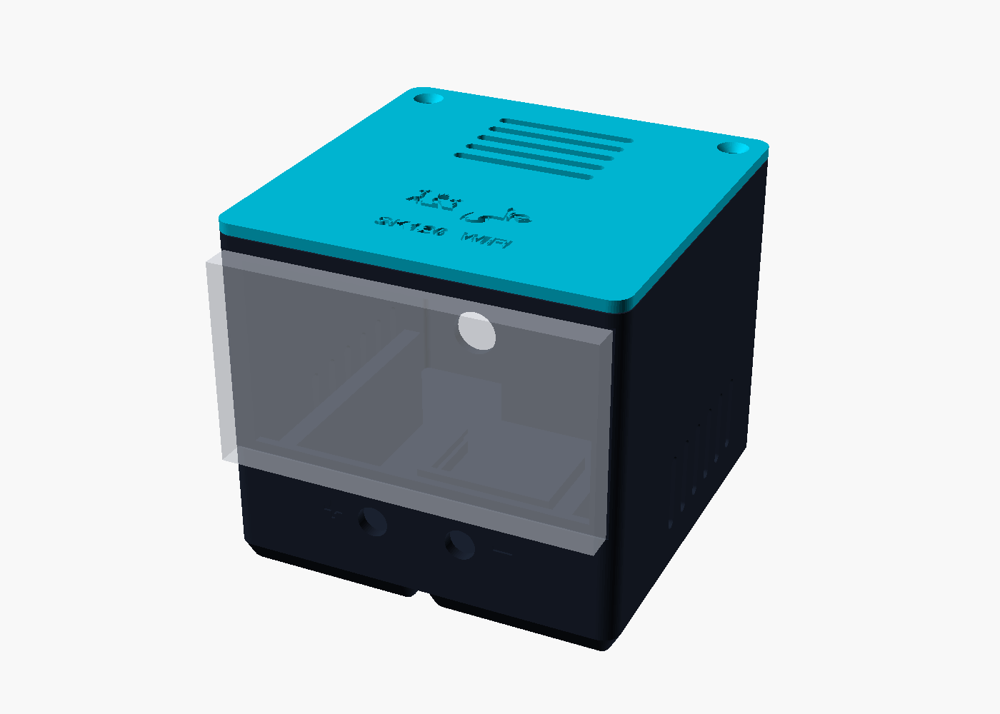
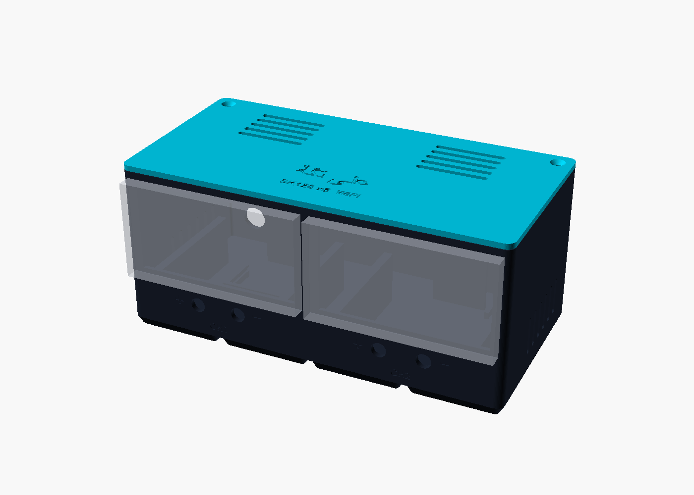

# علبة SK120 من «على تكّة» · Alatekka SK120 enclosure

<p align="center">
  
  
</p>

**تصميم أصلي مفتوح المصدر (MIT)** لعلبة تُطبع بالطابعة ثلاثية الأبعاد، بنسختين من نفس الملف:

| النسخة | المقاس | Gridfinity |
|---|---|---|
| **SK120 واحد** `UNITS = 1` | 83.5 × 83.5 × 76 مم | 2×2 |
| **SK120 اثنان** `UNITS = 2` (قناتان CH1 و CH2) | 167.5 × 83.5 × 76 مم | 4×2 |

> ⚠️ **الحالة: v0.1 تجريبية.** لم تُطبع بعد. المقاسات مأخوذة من مواصفات الـ SK120 المنشورة (79 × 43 مم للوجه، والعمق 62 مم مع المروحة)، والبائعون يختلفون بملليمتر أو اثنين. **قِس جهازك بالقدمة** وعدّل القيم في أول الملف قبل الطباعة.

## المميزات
- **قاعدة Gridfinity** مع أماكن لمغناطيس 6×2 مم: تثبت في أي درج أو قاعدة Gridfinity.
- **مخرج بنانا 4 مم** لكل قناة على الوجه، بمسافة 19 مم القياسية، مع علامات `+` و`−` محفورة.
- **مدخلان للكهرباء من الخلف:** فتحة جاك 5.5×2.1 (لشاحن لابتوب مثلاً) وفتحة USB-C لبوردة PD trigger، مع موجّهين يثبّتان البوردة.
- **مكان مخصص للـ ESP-01** على الأرضية تحت الـ SK120. البوردة تنزلق في مجرى ولا تحتاج غراء، والغطاء بلاستيك فالواي فاي لا ينحجب.
- **تهوية:** فتحات جانبية سفلية لدخول الهواء، وشبكة خلفية أمام مروحة كل SK120، وفتحات في الغطاء فوق الجزء الخلفي.
- **قضبان تحمل الـ SK120 من تحت** ومصدّ خلفي، فلا يعتمد الجهاز على مشابك اللوحة وحدها.
- **غطاء بحافة توجيه** وبرغيين M3 من الخلف، وعليه «على تكّة» محفورة.
- **ملف واحد بقيم قابلة للتعديل:** مقاسات الـ SK120، وقطر فتحات البنانا والجاك، وعدد الوحدات.

## الملفات
| الملف | الوصف |
|---|---|
| `sk120_case.scad` | المصدر (OpenSCAD 2021+) |
| `stl/sk120x1_body.stl`، `stl/sk120x1_lid.stl` | نسخة SK120 واحد |
| `stl/sk120x2_body.stl`، `stl/sk120x2_lid.stl` | نسخة SK120 اثنين |

## الطباعة
- **الخامة:** PETG أو ASA. الـ PLA يلين قرب الحرارة، والـ SK120 يسخن عند 100 واط فأكثر.
- **الطبقة:** 0.2 مم، **الجدران:** 3، **الحشوة:** 15–20% gyroid.
- **الجسم:** يُطبع على القاعدة كما هو. فتحة الـ SK120 الأمامية مسقوفة بجسر 72 مم، فإذا كانت طابعتك ضعيفة في الجسور فعّل الدعامات لهذه الفتحة فقط.
- **الغطاء:** الملف مقلوب جاهز للطباعة، والوجه المحفور على السطح.

## القطع
| القطعة | العدد لكل علبة |
|---|---|
| XY-SK120 | 1 أو 2 |
| ESP-01 أو ESP-01S | 1 |
| منظّم 3.3 فولت (مثل AMS1117-3.3) + مكثف 100 ميكروفاراد | 1 |
| جاك DC 5.5×2.1 للوحة (DC-022، فتحة 11 مم) **أو** بوردة USB-C PD trigger | 1 |
| مخرج بنانا 4 مم (بقلاووظ M6) | 2 لكل قناة |
| مغناطيس 6×2 مم (اختياري) | 16 أو 32 |
| برغي M3×8 ذاتي التسنين | 2 |
| سلك 18 AWG للتيار، وسلك رفيع للإشارة | |

## التجميع
1. ركّب الجاك أو بوردة USB-C في الخلف، ومخارج البنانا في الأمام.
2. أدخل الـ ESP-01 في مجراه على الأرضية (الإبر للأعلى) ووصّله بمنفذ الاتصال في الـ SK120. المنفذ يعطي **5 فولت**، فغذِّ الموديول عبر **منظّم 3.3 فولت** (التفاصيل في [docs/HARDWARE.md](../docs/HARDWARE.md)). بوردة المنظّم الصغيرة تُلصق على الأرضية بجانب المجرى.
3. وصّل الدخل ومخرج الـ SK120 إلى البنانا، ثم أدخل الـ SK120 من الأمام حتى تثبت مشابكه.
4. ضع الغطاء واربطه ببرغيين.

## توصيل جهازين بموديول واحد (UNITS = 2)
الـ SK120 يتكلم Modbus RTU، وكل جهاز له عنوان. اجعل الأول **1** والثاني **2** من قائمة الجهاز (`Adr`)، ونفس السرعة لكليهما (`bRE`).

```
ESP-01 TX ───────────────┬──────────► SK120 #1 RX
                         └──────────► SK120 #2 RX

             3.3V
              │
             10k
              │
ESP-01 RX ────┴──┬──|◄── SK120 #1 TX      (BAT54 / 1N4148:
                 └──|◄── SK120 #2 TX       الكاثود جهة الـ SK120)

GND ──────────── GND #1 ──── GND #2

SK120 #1 5V ──► منظّم 3.3V ──► ESP-01 3V3 + EN     (5V الجهاز الثاني لا يُوصل)
```
الـ TX من الجهازين لا يوصلان مباشرة ببعض، بل عبر ثنائيين (diode-OR) ومقاومة رفع. لا يتكلم إلا الجهاز الذي يُسأل، فلا يحصل تعارض.

> دعم جهازين في السوفت وير (قناتان CH1 و CH2 في نفس الصفحة) **قيد التطوير**؛ راجع CHANGELOG.

---

## English

An **original, open-source (MIT)** 3D-printable case for the XY-SK120, generated from one parametric OpenSCAD file:

- **`UNITS = 1`:** 83.5 × 83.5 × 76 mm, Gridfinity 2×2.
- **`UNITS = 2`:** 167.5 × 83.5 × 76 mm, Gridfinity 4×2. Two SK120s side by side (CH1, CH2), one shared DC input and one ESP-01.

> ⚠️ **Status: v0.1, not test-printed yet.** Dimensions come from published SK120 specs (79 × 43 mm bezel, 62 mm deep with fan), and sellers differ by a millimetre or two. **Measure your unit** and edit the SK120 block at the top of the file before printing.

**Features:**
- **Gridfinity base** with 6×2 mm magnet pockets.
- **4 mm banana outputs** per channel, 19 mm spacing, with engraved `+` / `−`.
- **Two input options at the rear:** a 5.5×2.1 DC jack or a USB-C PD trigger board, with floor guides for the board.
- **ESP-01 cradle** on the floor under the SK120. The board slides in, and the plastic lid keeps WiFi clear.
- **Ventilation:** side intake slots, a rear grille in front of each SK120 fan, and lid exhaust slots.
- **Support:** rails under each SK120 plus a rear stop.
- **Lid:** locating lip, two M3 screws, engraved «على تكّة» logo.

**Print:** PETG or ASA, 0.2 mm layers, 3 walls, 15–20 % gyroid. The front opening is a 72 mm bridge; add supports there if your printer bridges poorly. The lid STL is already flipped for printing.

**Dual wiring:** set the SK120 addresses to 1 and 2 (`Adr`) with the same baud (`bRE`). Wire ESP TX to both RX pins. Bring both TX pins to ESP RX through a diode-OR (BAT54 / 1N4148, cathode toward the SK120) with a 10 k pull-up to 3.3 V, and join all grounds. Power the ESP-01 from **one** SK120 5 V pin through a 3.3 V regulator (AMS1117-3.3 or similar), never directly. Firmware support for two channels is in progress.
